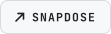
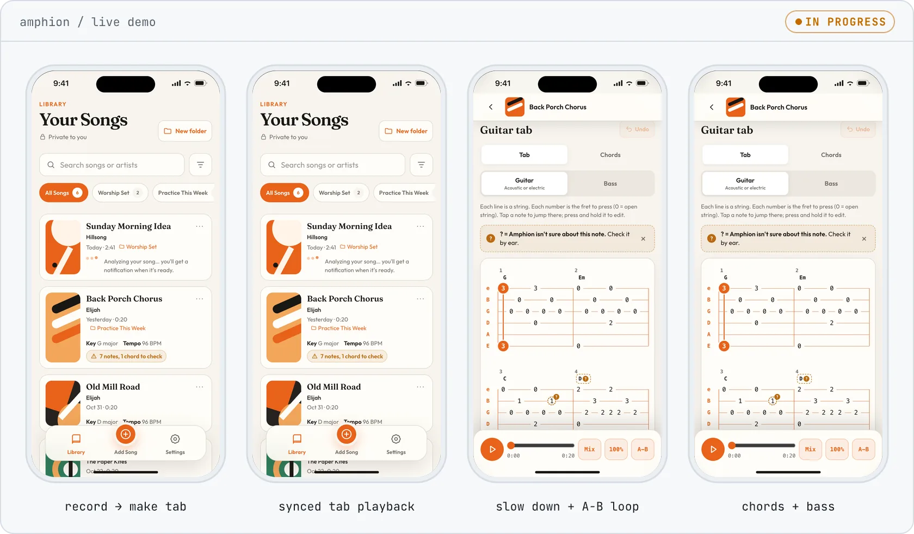
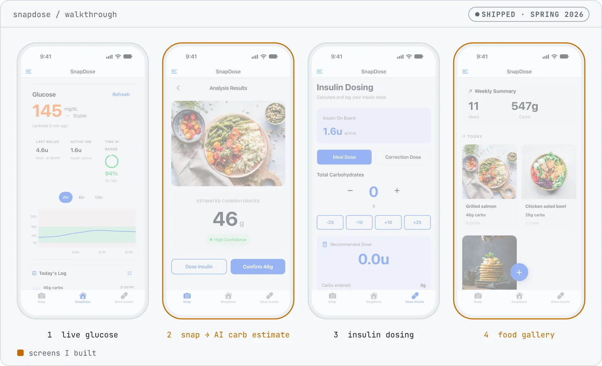

<a href="https://github.com/etabor3096/Amphion">
<picture>
  <source media="(prefers-color-scheme: dark)" srcset="./assets/header-dark.svg">
  
</picture>
</a>

Computer science student who likes building the whole thing: the webhook that pulls the data in, the CLI and auth around it, and the app someone actually holds. Lately that means AI tools for developers and an app that teaches guitar.

**Studying:** &nbsp; Computer Science · California Baptist University 
**Building:** &nbsp; Amphion, an iOS app that turns songs into guitar and bass tabs 
**Capstone:** &nbsp; Ember, shared project context for AI coding agents

<a href="https://github.com/etabor3096/Amphion"><picture><source media="(prefers-color-scheme: dark)" srcset="./assets/buttons/amphion-dark.svg"></picture></a>
<a href="https://github.com/cbu-capstone-design-27/ember"><picture><source media="(prefers-color-scheme: dark)" srcset="./assets/buttons/ember-dark.svg"></picture></a>
<a href="https://github.com/cbu-jr-design-26/snap-dose"><picture><source media="(prefers-color-scheme: dark)" srcset="./assets/buttons/snapdose-dark.svg"></picture></a>

 

<picture>
  <source media="(prefers-color-scheme: dark)" srcset="./assets/headings/now-dark.svg">
  
</picture>

### [Amphion](https://github.com/etabor3096/Amphion)

**Songs in, playable guitar and bass tabs out.** · Oct 2026 – now

<a href="https://github.com/etabor3096/Amphion"><picture><source media="(prefers-color-scheme: dark)" srcset="./assets/projects/amphion-dark.webp"></picture></a>

Beginners learn guitar by playing songs they love, but plenty of songs have no tabs, and the ones that exist are often wrong. Amphion listens to a recording or an uploaded file, separates the guitar and bass from the mix, detects the notes, puts each one on a string and fret, and locks them to the song's beat grid. The tab scrolls with the audio while you play along. You can slow it down, loop a hard section, or tap a note to jump to it, and notes the model isn't sure about are flagged instead of hidden.

`iOS` `Audio source separation` `Pitch detection` `Beat tracking`

 

<picture>
  <source media="(prefers-color-scheme: dark)" srcset="./assets/headings/projects-dark.svg">
  
</picture>

### [Ember](https://github.com/cbu-capstone-design-27/ember)

**Senior capstone. Shared project context for AI coding agents, served over MCP.** · Sep 2026 – now

<a href="https://github.com/cbu-capstone-design-27/ember"><picture><source media="(prefers-color-scheme: dark)" srcset="./assets/projects/ember-dark.svg"></picture></a>

Coding agents start every session knowing only the code. Ember collects the reasons behind it from GitHub, GitLab, Jira and Slack, stores them in Postgres with pgvector embeddings, and serves search to agents through an MCP server. I built the GitLab connector, which verifies signed webhooks and backfills merge requests, issues and notes through the REST API. I also built the Rust CLI (`ember status`, `ember auth login`) and organizations in the web app: create, invite, switch, and link to a tenant.

`Python` `Rust` `TypeScript` `Next.js` `PostgreSQL` `pgvector` `MCP` `Docker`

### [SnapDose](https://github.com/cbu-jr-design-26/snap-dose)

**Junior design. Snap a meal, get a carb estimate, send the insulin dose.** · Spring 2026

<a href="https://github.com/cbu-jr-design-26/snap-dose"><picture><source media="(prefers-color-scheme: dark)" srcset="./assets/projects/snapdose-dark.webp"></picture></a>

A Type 1 Diabetes app that shows live glucose from Dexcom, estimates carbs from a meal photo with Gemini, calculates the bolus, and sends it to a simulated insulin pump. I built the camera flow and local photo saving, the AI confirmation screen, and the food gallery with its weekly view and meal details. I also tuned the Gemini request and added haptics and loading feedback.

`React Native` `Expo` `Firebase` `Gemini API` `Spring Boot`

 

<picture>
  <source media="(prefers-color-scheme: dark)" srcset="./assets/headings/toolbox-dark.svg">
  
</picture>

**Languages:** &nbsp; `TypeScript` `Python` `Rust` `Java` `JavaScript` `C++` 
**Frameworks:** &nbsp; `Next.js` `React Native` `Expo` `Spring Boot` 
**Data and AI:** &nbsp; `PostgreSQL` `pgvector` `Firebase` `Gemini API` `MCP` 
**Workflow:** &nbsp; `Git` `GitHub` `Docker` `Jira`

 

<picture>
  <source media="(prefers-color-scheme: dark)" srcset="./assets/footer-dark.svg">
  
</picture>

<!-- The SVGs in assets/ are generated by tools/build_assets.py. Edit the script, not the SVGs. -->
